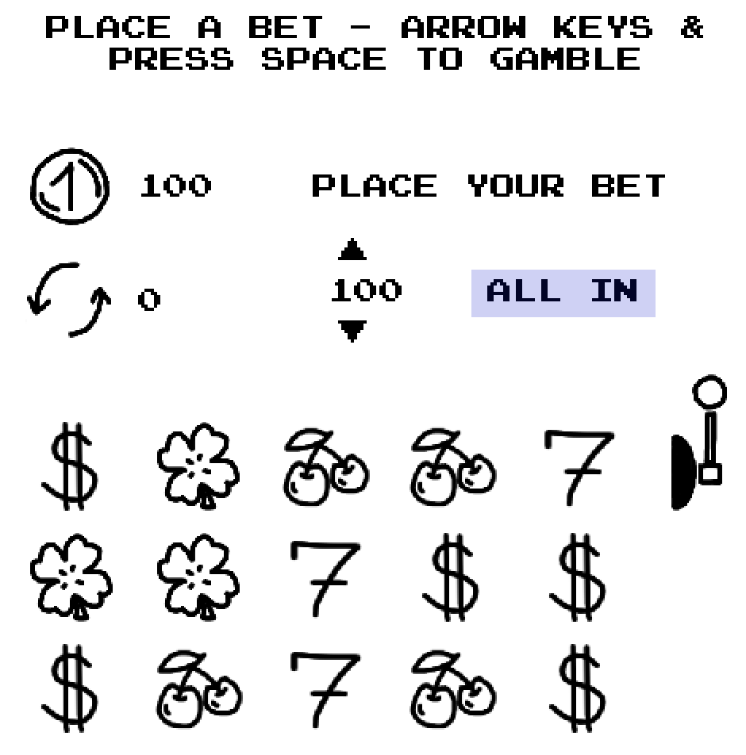
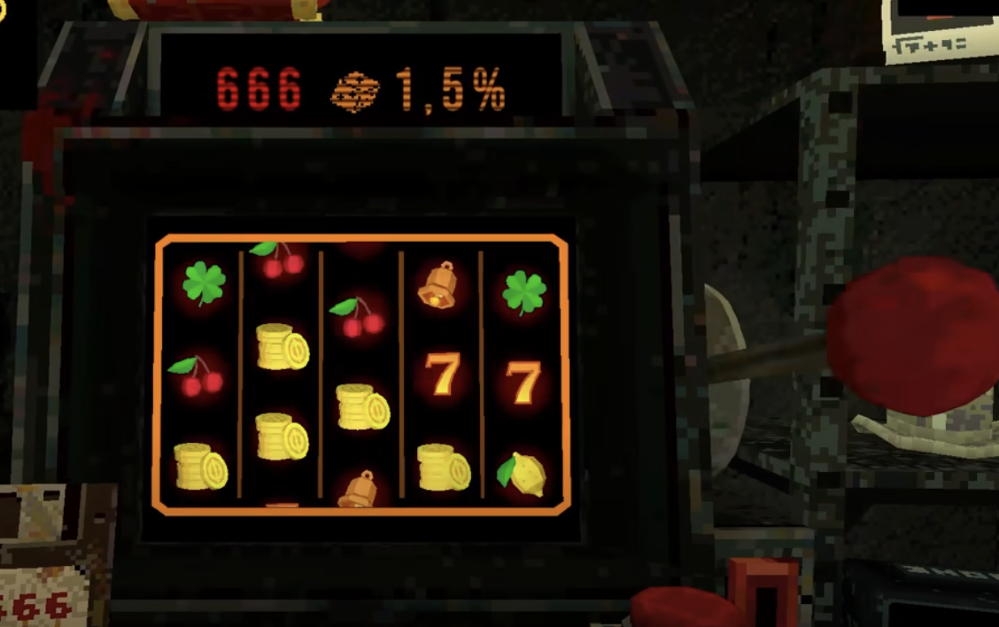

**ULTRA GAMBLER** ist ein kleines Spaßprojekt, in das ich unglaublich viel Freude, aber auch Zeit investiert habe. Wie der Name schon sagt, geht es um ein Zufallsspiel: eine sogenannte Slotmaschine. Man zieht am Hebel und hofft, so viele gleiche Symbole wie möglich in einer Kette zu erhalten, um das gesetzte „Geld“ zu vervielfachen.

Ich setze in dem Spiel besonders auf die Animationen und die Smoothness des eigentlichen Gameplays, alles soll flüssig und angenehm wirken. Als Inspiration diente überwiegend das Indie-Projekt *[Clover Pit](https://store.steampowered.com/app/3314790/CloverPit/)*
. Das ist ein sehr angenehmes Spiel mit großen Zahlen, das auf einer ähnlichen Mechanik basiert. Dennoch ist es mir persönlich etwas zu überladen. Viele zusätzliche Buffs und Upgrades schieben die eigentliche (und relativ spannende) Mechanik des Rollens bzw. Spins in den Hintergrund. Ich habe versucht, in diesem Projekt genau diese Kernmechanik zu erreichen.

Die Steuerung des Spiels sollte ebenfalls recht intuitiv sein. Es sind letztlich nur die Pfeiltasten, um den Betrag zu setzen, und die Leertaste, um das Ganze rollen zu lassen.

Die Logik hinter dem Spin ist recht simpel: Fallen auf dem Tableau mehr als drei Symbole, die diagonal oder direkt benachbart sind, hat man einen Gewinn gemacht (oder zumindest nicht verloren). Sie werden farblich gekennzeichnet. Bei vier Symbolen kriegt man den ursprünglich gesetzten Wert zurück und ist quasi bei $\pm 0$. Jedes weitere Symbol multipliziert den Einsatz: Bei fünf Symbolen mal 2, bei sechs Symbolen mal 3 usw.

Das Projekt basiert auf einer Single-Header-Library und braucht keine weiteren Installationsschritte. Damit es auf meinem Mac laufen konnte, war initial libpng nötig `brew install libpng`. Dennoch ist die Library jetzt fest in die Executable eingebettet, was auch auf anderen Geräten erfolgreich geprüft wurde. Ich gehe fest davon aus, dass du hierbei keine Hilfe brauchen wirst. :)

Ansonsten kann ich nur sagen, dass ich recht stolz auf das Ergebnis bin. Den Code habe ich versucht, so sauber wie möglich zu schreiben. An einer Stelle habe ich auch Smart Pointer verwendet und hoffe, dass ich mich richtig an die Vorlesung erinnert habe, was deren Nutzung angeht.

## Skizzen zum Projekt

Ich wollte ursprünglich welche im Nachgang zum Projekt machen (ja, ich weiß, nicht die schlauste Reihenfolge xD), dennoch kam das Spiel meinen Vorstellungen so unglaublich nahe, dass ich gar nicht mehr viel zeichnen muss, um die Idee besser ausdrücken zu können.

## Meine Inspiration 
 [*BILDQUELLE: Clover Pit*](https://store.steampowered.com/app/3314790/CloverPit/)
